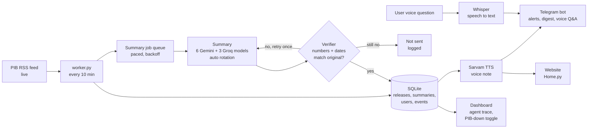

# BharatBrief

**Government press releases, explained in your language, checked number by number, delivered as voice.**

## 🚀 Live prototype

| | Link |
|---|---|
| **Telegram bot (primary product)** | **https://t.me/user_verifbot** |
| Website (companion) | https://bharatbrief-j3e3.onrender.com/?lang=hi |

Open the bot, tap **Start**, pick a language and who you are: the first verified news arrives with a voice note.
The website is hosted on Render's free tier; if it has been idle, the first load can take up to a minute.

## The problem

The Press Information Bureau (PIB) publishes new government announcements every day: scheme deadlines,
rule changes, new benefits. They are written in formal Hindi or English, and most citizens never see them
or cannot act on them. Existing tools answer questions about a fixed list of schemes; none of them watches
the daily releases, explains each one in simple words, and pushes it to the people it affects.

**Who is affected:** farmers, students, small businesses (MSMEs) and women who depend on schemes and
deadlines, especially people who prefer their own language or listening over reading.

## What BharatBrief does

1. **Watches PIB live** every 10 minutes and stores every new release.
2. **Explains each release simply** in 23 Indian languages (voice in 11): what happened, how it affects you, what you should do.
3. **Verifies every number and date** in the summary against the original release. A wrong summary is
   retried once with the error fed back to the model; if it is still wrong, it is **not sent**.
4. **Speaks it**: an AI voice note in the same language (male or female voice, user's choice), labelled as AI-generated.
5. **Pushes it to the right people** on Telegram (matched by role) and shows it on a public website.
6. **Answers questions by voice**: hold the mic and ask; the answer comes only from that release, with paragraph citations.
7. **Morning digest and reminders**: top 3 stories as one voice note at 8 AM, and one-tap reminders for deadlines.

### On Telegram

- Big menu buttons, no commands to learn: 📰 Today's news · 🌅 Top 3 · 🎙️ Ask · ⚙️ Settings
- ➡️ Next story (news for your role first), 📤 Share on WhatsApp with the official source link
- Two-tap setup: language first, then who you are

## Architecture



## What makes it robust

| Failure | What the system does |
|---|---|
| Gemini busy / quota over | Retries with backoff, then rotates through 6 Gemini and 3 Groq models automatically |
| A model is retired | Groq model is picked automatically from the live model list |
| AI writes a wrong number or date | Verifier catches it, retries with feedback, blocks it if still wrong |
| PIB is down | Shows the last data with a clear notice; nothing crashes (demo toggle on the dashboard) |
| Any API hangs | Every call has a timeout |
| Many processes, one database | SQLite in WAL mode with a 30 s busy timeout; bot and worker auto-restart on crash |
| Same news twice | PRID-based de-duplication and a `sent_log`, so nobody gets a message twice |

## Tech stack

Python · SQLite (WAL) · Streamlit · python-telegram-bot · Google Gemini / Gemma · Groq (Qwen, GPT-OSS, Whisper) ·
Sarvam AI (Bulbul v3 TTS) · ffmpeg · Docker · Render

**Data source:** PIB press-release RSS (`https://pib.gov.in/RssMain.aspx?ModId=6&Lang=2&Regid=3`) and the
release pages it links to. No mock data: everything shown is fetched live.

## Run it locally

```bash
pip install -r requirements.txt
```

Create a `.env` file (never commit it):

```
GEMINI_API_KEY=...
GROQ_API_KEY=...
SARVAM_API_KEY=...
TELEGRAM_BOT_TOKEN=...
```

Then, in three terminals:

```bash
python worker.py                      # updates every 10 minutes
python bot.py                         # Telegram bot
python -m streamlit run Home.py       # website + dashboard
```

Health check before a demo: `python check_apis.py`

## Project files

| File | Role |
|---|---|
| `collector.py` | PIB feed, release text, posted time, SQLite |
| `summarize.py` | Multilingual summary, Gemini with Groq fallback |
| `groq_pick.py` | Picks a working Groq model automatically |
| `verify.py` | Checks every date and number against the original |
| `voice.py` | Verified summary to Sarvam voice |
| `audio_util.py` | WAV to OGG/Opus for Telegram voice notes |
| `alerts.py` | Audience matching, cache, push alerts |
| `bot.py`, `bot_text.py` | Telegram bot: menu, next story, share, settings, voice Q&A |
| `voice_input.py` | Voice question to text (Whisper) |
| `qa.py` | Answers from the release's own paragraphs, with citations |
| `digest.py`, `reminders.py` | 8 AM digest, deadline reminders |
| `jobqueue.py`, `dbfix.py` | Paced summary queue, SQLite WAL setup |
| `worker.py`, `auto_updater.py` | Background updates every 10 minutes |
| `trace_log.py` | Event log (agent trace) and demo settings |
| `Home.py`, `pages/2_Dashboard.py` | Website and dashboard |
| `check_apis.py` | One-command health check of every API |

## Limitations and roadmap

- The free server's disk is temporary; the next step is a hosted Postgres database.
- Voice for the remaining 12 languages (Bhashini), WhatsApp channel.
- eGazette notifications with clause-level "what changed" alerts.
- An MSME compliance calendar from GST and RBI notices.

